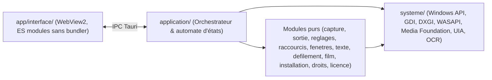

<div align="center">


# BreezyShot

**Outil de capture d'écran rapide, natif et hors ligne pour Windows 11** *(macOS ensuite)* — dans l'esprit de CleanShot X.  
Propulsé par **Tauri 2** : un cœur en **Rust**, une interface web pure **sans bundler**.

[](https://github.com/Moon-ItachiDEV/BreezyShot/actions/workflows/app.yml)
[](https://github.com/Moon-ItachiDEV/BreezyShot/releases)
[](https://github.com/Moon-ItachiDEV/BreezyShot/releases)
[](#architecture)
[](LICENSE.md)

[Fonctionnalités](#fonctionnalités) · [Installation](#installation) · [Raccourcis clavier](#raccourcis-clavier) · [Architecture](#architecture) · [Développement](#développement) · [Licence](#licence)

</div>

---

## Pourquoi BreezyShot ?

- **Instantané & natif** — Capture par gel d'écran natif, gestion multi-écran **Per-Monitor DPI V2** au pixel physique près, chargement différé des DLL Windows (`winmm`, Media Foundation) et zéro surcharge inutile au repos.
- **100 % hors ligne & respectueux de la vie privée** — Aucun accès réseau, aucune télémétrie, aucun compte requis. Ni images, ni contenu du presse-papiers, ni texte OCR/QR ne sont jamais écrits dans le journal.
- **Éditeur complet prêt à partager** — Annotations vectorielles non destructives, gomme au pixel, flèches courbées, masquage de secrets, projecteur et **fond d'éditeur** (dégradés, couleur unie, marges, coins arrondis, ombre portée).
- **Conception stricte & vérifiée** — Interface web ES modules pure sans bundler, frontières de modules contrôlées automatiquement par test d'architecture ([`tests/architecture.rs`](app/coeur/tests/architecture.rs)), plus de 1 300 tests Rust, 16 suites Playwright/Node et 15 essais Windows de bout en bout.

---

## Fonctionnalités

### Captures & flux quotidien

- **Quatre modes de capture** : Zone (avec loupe de précision), Plein écran, Fenêtre (coins arrondis Windows 11 préservés) et Refaire la dernière zone.
- **Barre de capture « Galet »** : accès rapide en haut de l'écran au lancement manuel, avec retardateur intégré (`3`, `5` ou `10 s`).
- **Vignette interactive** : aperçu flottant configurable, copie, enregistrement, annotation, suppression annulable et **glisser-déposer direct** vers n'importe quelle application.
- **Personnalisation complète** : formats **PNG, JPG et WebP**, modèle de nommage, capture du pointeur, son de capture (« Goutte »), ouverture directe dans l'éditeur, raccourcis configurables (y compris la touche `Impr. écran`), thème clair / sombre / système et lancement avec Windows.

### Éditeur d'annotation

- **Outils d'annotation** : Flèche (droite ou courbée à la poignée centrale), Formes (Rectangle, Ellipse, Ligne), Texte, Numéros auto-incrémentés, Stylo, Surligneur.
- **Confidentialité & mise en valeur** : Masques **Pixeliser**, **Flouter** et **Bloc noir** (opaque sans fuite), **Projecteur** (rectangle ou ovale) et **Gomme** au pixel sur les encres.
- **Fond d'éditeur (`F`)** : habillage instantané avec 6 dégradés ou couleur unie libre, 3 tailles de marge (`32`, `56`, `88 px`), coins arrondis (`0`, `12`, `20 px`) et ombre portée, identique à l'aperçu comme à l'export.
- **Productivité** : recadrage par équerres, historique Annuler / Rétablir sur 200 pas, copie directe (`Ctrl + C`), enregistrement rapide (`Ctrl + S`), Enregistrer sous… (`Ctrl + Maj + S`) et glisser-déposer de l'image annotée.

### Fonctions Pro *(licence hors ligne)*

Toutes les fonctionnalités Pro vivent dans le même exécutable et se débloquent hors ligne via une clé signée **Ed25519** dans **Réglages › Général › Licence** *(une clé d'essai publique est disponible dans [`essais/licence-essai.txt`](essais/licence-essai.txt))*.

| Fonction | Description |
| --- | --- |
| **Historique** | Les 50 dernières captures consultables instantanément : copier, enregistrer, annoter, glisser-déposer et annuler une suppression (`Ctrl + Z`). |
| **Copier le texte (OCR & QR)** | Extraction de texte par `Windows.Media.Ocr` (sur l'écran ou dans l'éditeur) et décodage automatique des QR codes (liens sûrs, Wi-Fi, texte). |
| **Capture défilante** | Défilement automatique (UI Automation) avec reprise à la molette et assemblage continu jusqu'à `16 384 px` de haut. |
| **Vidéo MP4 & GIF** | Enregistrement H.264 (Media Foundation) ou GIF optimisé, avec micro, son système (WASAPI loopback) et anneaux de clics visibles. |
| **Fichiers `.breezy`** | Enregistrement et réouverture de captures modifiables conservant l'image d'origine, les annotations et le fond. |

---

## Installation

1. Téléchargez la dernière version d'essai depuis la page **[Releases](https://github.com/Moon-ItachiDEV/BreezyShot/releases)**.
2. Lancez le fichier `.exe` téléchargé *(il fait office d'installateur autonome ; Windows SmartScreen peut demander confirmation car les versions d'essai ne sont pas encore signées)*.
3. Cliquez sur **Installer**.

Pour désinstaller proprement : **Paramètres Windows › Applications › Applications installées › BreezyShot**.  
Un guide complet de prise en main est disponible dans [`docs/ESSAI.md`](docs/ESSAI.md).

---

## Raccourcis clavier

### Raccourcis globaux par défaut (Windows)

Tous les raccourcis sont modifiables à chaud dans **Réglages › Raccourcis**.

| Action | Raccourci par défaut | Portée |
| --- | --- | --- |
| Capturer une zone | `Ctrl + Maj + 1` *(ou `Impr. écran`)* | Gratuit |
| Capturer le plein écran | `Ctrl + Maj + 2` | Gratuit |
| Capturer une fenêtre | `Ctrl + Maj + 3` | Gratuit |
| Refaire la dernière zone | `Ctrl + Maj + 4` | Gratuit |
| Capture défilante | `Ctrl + Maj + 5` | Pro |
| Enregistrer une vidéo (MP4) | `Ctrl + Maj + 6` | Pro |
| Enregistrer un GIF | `Ctrl + Maj + 7` | Pro |
| Copier le texte (OCR / QR) | `Ctrl + Maj + T` | Pro |
| Ouvrir l'historique | `Ctrl + Maj + H` | Pro |

### Dans l'éditeur

| Raccourci | Action |
| --- | --- |
| `F` | Ouvrir / fermer le panneau **Fond** |
| `Ctrl + Z` / `Ctrl + Y` | Annuler / Rétablir |
| `Ctrl + C` | Copier dans le presse-papiers sans fermer |
| `Ctrl + S` / `Ctrl + Maj + S` | Enregistrer / Enregistrer sous… |
| `Échap` | Fermer le panneau actif ou quitter l'éditeur |

---

## Ligne de commande & diagnostic

L'exécutable fonctionne en **instance unique** : une seconde invocation relaie l'ordre à l'instance en cours.

| Commande | Comportement |
| --- | --- |
| `breezyshot.exe` | Lance l'application et ouvre la barre de capture (ou l'ouvre dans l'instance active). |
| `breezyshot.exe --discret` | Démarre silencieusement dans la zone de notification (utilisé au démarrage de Windows). |
| `breezyshot.exe --capturer <mode>` | Lance une capture (`zone`, `plein_ecran`, `fenetre`, `derniere_zone`, `texte`, `defilante`, `video`, `gif`). |
| `breezyshot.exe <fichier>.breezy` | Rouvre un fichier `.breezy` dans l'éditeur. |
| `breezyshot.exe --quitter` | Ferme proprement l'instance en cours. |
| `breezyshot.exe --desinstaller` | Lance la désinstallation. |

- **Réglages** : `%APPDATA%\BreezyShot\reglages.json`
- **Journal** : `%LOCALAPPDATA%\BreezyShot\Journal\breezyshot.log` *(rotation 5 × 1 Mo)*
- **Bac à sable d'essai** : définir `BREEZYSHOT_DOSSIER_ESSAI` redirige réglages, journaux et images dans ce dossier.

---

## Architecture

Le projet sépare strictement l'orchestration, la logique pure et les appels système. Une règle vérifiée automatiquement par [`app/coeur/tests/architecture.rs`](app/coeur/tests/architecture.rs) interdit tout couplage direct entre modules métiers et confine tout le code spécifique à l'OS dans `systeme/`.



<details>
<summary><strong>Arborescence détaillée du dépôt</strong></summary>

```text
.github/workflows/app.yml      CI GitHub Actions (Windows, macOS, Chromium) et pré-versions
app/
  package.json                 Fige uniquement Tauri CLI et Playwright (aucun bundler)
  coeur/                       Crate Rust `breezyshot` & configuration Tauri
    src/
      application/             Automate d'états, journal, arguments, icône/menu, gestes
                               (dont editeur.rs, geste_editeur.rs, fenetre_editeur.rs)
      capture/                 Géométrie, découpe, fenêtres arrondies, pointeur, anneaux de clics
      sortie/                  Presse-papiers, PNG/JPG/WebP, historique, glisser, archives .breezy
      reglages/                Modèle, validation, lecture/écriture atomique
      raccourcis/              Raccourcis globaux et touches d'annulation
      fenetres/                Placement et cycle de vie des fenêtres Tauri
      texte/                   Préparation OCR et décodage QR (rqrr)
      defilement/              Recalage et assemblage de la capture défilante
      film/                    Horloge, diff d'images, encodage GIF et mixage audio
      installation/            Logique pure de l'installateur et désinstallateur
      droits.rs & licence/     Contrôle des fonctions Pro et vérification Ed25519 hors ligne
      systeme/                 Façade OS unique (`windows.rs`, `autre.rs`, sous-modules natifs)
    tests/architecture.rs      Vérification statique des dépendances et frontières OS
  interface/                   Pages web natives sans bundler
    commun/                    Jetons CSS générés (`jetons.css`), thème, pictogrammes
    barre/  menu/  selection/  vignette/  editeur/  historique/  reglages/
    defilante/  film/  installateur/
design/                        Jetons du design system (`jetons*.json`) et icônes Moulinet
outils/generer-jetons.mjs      Générateur et vérificateur de `app/interface/commun/jetons.css`
essais/                        15 scénarios PowerShell Windows + 16 suites Playwright/Node (`pages/`)
docs/                          Contrat technique (`ARCHITECTURE.md`), suivi (`TRAVAIL-VALIDE.md`), guide (`ESSAI.md`)
```

</details>

Pour les spécifications complètes, le protocole IPC et les contrats de chaque module, consultez [`docs/ARCHITECTURE.md`](docs/ARCHITECTURE.md) et [`docs/TRAVAIL-VALIDE.md`](docs/TRAVAIL-VALIDE.md).

---

## Développement

### Prérequis

- **Rust** `1.97+` (`rustfmt`, `clippy`)
- **Node.js** `22+` (`npm`)
- **Windows 11** avec WebView2 pour la compilation de l'exécutable et les essais natifs *(les essais d'interface tournent aussi sous Linux et la vérification Rust tourne sous macOS)*

### Vérifications et build Rust

```bash
cd app/coeur
cargo fmt --check
cargo clippy --locked --all-targets -- -D warnings
cargo test --locked
```

```bash
# Construire l'exécutable autonome release (Windows)
cd app
npm ci
npx tauri build --no-bundle -- --locked
# -> app/coeur/target/release/breezyshot.exe
```

### Jetons du design system

```bash
# Régénérer app/interface/commun/jetons.css après édition de design/jetons*.json
node outils/generer-jetons.mjs

# Vérifier que jetons.css est synchronisé
node outils/generer-jetons.mjs --verifier
```

### Essais automatisés

```bash
# 16 suites d'interface & modèle d'éditeur (Chromium / Node)
cd app && npx playwright install chromium && cd ..
for f in essais/pages/*.cjs; do NODE_PATH=app/node_modules node "$f"; done
```

```powershell
# 15 scénarios de bout en bout sur Windows
pwsh essais/lancer.ps1 -Exe app/coeur/target/release/breezyshot.exe
```

---

## Licence

Distribué sous licence **[FSL-1.1-MIT](LICENSE.md)** *(Functional Source License, Version 1.1, avec bascule automatique en licence **MIT** deux ans après chaque publication)*.

- Utilisation libre pour un usage personnel, interne, éducatif, de recherche ou de prestations de services.
- Seule la réutilisation dans un produit ou service commercial concurrent est exclue pendant les 2 ans suivant la sortie d'une version.

---

<div align="center">
  <sub>Conçu avec soin par <a href="https://github.com/Moon-ItachiDEV">Moon-ItachiDEV</a> · <a href="docs/ARCHITECTURE.md">Architecture</a> · <a href="docs/ESSAI.md">Guide d'essai</a> · <a href="https://github.com/Moon-ItachiDEV/BreezyShot/releases">Téléchargements</a></sub>
</div>
